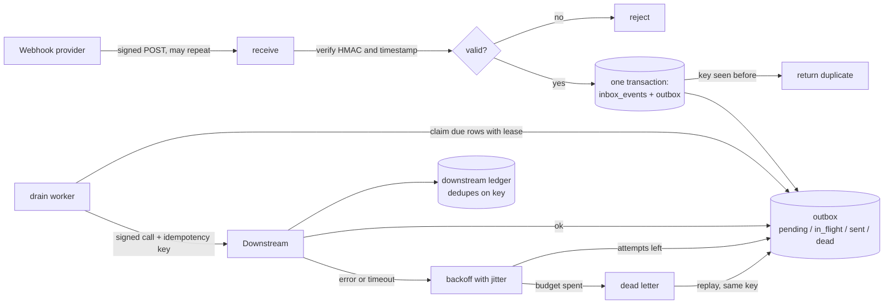

# webhook-reliability-kit

Webhooks arrive twice, out of order, or forged, and outbound calls time out after the other side already acted.
Without a plan for that, you either lose work or do it twice.

This is a small, dependency free Python kit (standard library plus SQLite) that shows the patterns that fix it, with a seeded chaos test that proves the result.

## What it does

- **Signature verification.** HMAC-SHA256 over `timestamp.body`, constant time compare, a tolerance window that rejects old captures, and a secret list so a secret can be rotated without dropping traffic.
- **Idempotency keys on the way in.** Each inbound event is recorded by key. A redelivery returns `duplicate` and does nothing. The same key with a different body is refused as a conflict.
- **Transactional outbox.** The inbound dedupe row and the outbound work it triggers are written in one SQLite transaction, so an accepted event always has its follow up queued, exactly one time.
- **Drain worker.** Claims due rows under a lease, calls the downstream, and on failure reschedules with exponential backoff and full jitter. A worker that dies mid call leaves a lease that expires, and the row is picked up again.
- **Dead letter.** After `max_attempts` the row is parked as `dead` with its last error, and every attempt is kept in `delivery_attempts`.
- **Replay.** A dead (or already sent) row can be put back in the queue with a fresh budget. It keeps its idempotency key, so replaying something that already landed is harmless.
- **Chaos test.** A fake downstream fails at random from a seeded generator, both before applying an effect and after applying it (response lost). The test asserts every accepted event produced exactly one ledger entry and that balances match to the cent. A control run with downstream dedupe turned off must fail, which shows the test has teeth.

The honest framing: delivery is at least once. The effect is exactly once because the downstream dedupes on the idempotency key the sender attaches to every attempt.

## Architecture



| File | Role |
| --- | --- |
| `webhook_kit/signing.py` | sign and verify |
| `webhook_kit/inbox.py` | verify, dedupe, enqueue in one transaction |
| `webhook_kit/outbox.py` | enqueue, claim, drain, dead letter, replay |
| `webhook_kit/backoff.py` | exponential backoff with full jitter |
| `webhook_kit/downstream.py` | seeded flaky downstream with its own ledger database |
| `webhook_kit/chaos.py` | the end to end scenario used by the tests and the demo |
| `webhook_kit/db.py`, `clock.py` | schema, injectable clock |

## Run it

Needs Python 3.9 or newer. Nothing to install for the demo.

```
python demo/run_demo.py
```

Options: `--seed N`, `--events N`, `--log-lines N`. The same seed always prints the same output. The process exits non zero if the safe run is not exactly once, or if the control run fails to show duplicates.

## Tests

```
python -m pip install -r requirements-dev.txt
python -m pytest -q
```

52 tests: signing, backoff bounds, inbox dedupe and rollback, outbox retry, dead letter, replay, lease recovery after a crash, two workers on one database file, and the chaos suite across six seeds plus its control.

## Demo

The captured run is in [`demo/output.txt`](demo/output.txt). The short version, seed 7, 60 events:

```
Run 1: downstream dedupes on the idempotency key
  inbound deliveries        100
    accepted                60
    deduped redeliveries    34
    rejected bad signature  6
  downstream calls          118
    retries scheduled       53
    worker crashes          2
    dead lettered           4 (max 4 attempts)
    replayed after heal     4
    duplicates suppressed   17
  effects missing: 0   effects applied twice or more: 0
  exactly once: YES

Run 2: same seed, downstream ignores the key (control)
  effects missing: 0   effects applied twice or more: 13
  exactly once: NO
```

Sixty events took 118 calls to deliver. Seventeen of those calls were repeats of an effect that had already landed, and the key absorbed every one. In the control run the same repeats became double credits.

## Using the pieces

```python
from webhook_kit import connect, receive, enqueue, drain_once, BackoffPolicy
import json, random, time

conn = connect("kit.db")

def handler(tx, event):                      # runs inside the inbox transaction
    enqueue(tx, f"{event['id']}:notify", "notify", json.dumps(event), time.time())

receive(conn, raw_body, signature_header, ["current-secret", "previous-secret"], time.time(), handler)

def send(row):                               # raise on failure
    post(row["destination"], row["payload"], headers={"Idempotency-Key": row["idempotency_key"]})

drain_once(conn, send, time.time(), random.Random(), BackoffPolicy(max_attempts=6))
```

`post` is yours to supply. The kit ships no HTTP client or server on purpose: transport is the easy part, and keeping it out keeps the demo offline.

## Configuration

All optional, see `.env.example`. The kit does not load `.env` files itself; export the variables in your shell if you want to override the built in fake values.

| Variable | Meaning | Default |
| --- | --- | --- |
| `WEBHOOK_KIT_INBOUND_SECRET` | secret for inbound signatures in the demo | fake placeholder |
| `WEBHOOK_KIT_OUTBOUND_SECRET` | secret for outbound signatures in the demo | fake placeholder |
| `WEBHOOK_KIT_DB` | SQLite path for the sender side | `:memory:` |

## Where this pattern runs

This is a clean room rewrite of a pattern drawn from systems that run two small service companies day to day, where inbound events from third party tools trigger alerts and follow up calls that must not be lost and must not fire twice. No code or data is shared with those systems; this repository rebuilds the ideas on SQLite with synthetic data so they can be read and run in a minute.

## Limitations

- **Exactly once depends on the downstream.** If the receiver does not dedupe on the idempotency key, retries will double apply. The control run shows exactly that. Nothing on the sender side can fix it.
- **Simulated chaos, not real networks.** Failures, crashes and time are simulated in one process with a fake clock. There is no real HTTP, no real process kill, and no partial write or disk failure testing.
- **SQLite means one writer at a time.** Claims use `BEGIN IMMEDIATE`, which is correct for several workers on one file (tested with two connections) but will not scale past one machine. A Postgres version would claim with `FOR UPDATE SKIP LOCKED`.
- **A crash costs the whole claimed batch an attempt.** The attempt counter is bumped at claim time, so rows that were claimed but not yet tried when the worker died still lose one attempt. Use a small batch or a generous budget.
- **A crash on the final attempt is dead lettered with outcome unknown.** The effect may or may not have landed. Replay is safe only because the key is kept.
- **No ordering guarantee.** Rows for the same entity can be delivered out of order after retries.
- **Inbox and dedupe rows are never pruned.** A real deployment needs a retention window for `inbox_events`, `delivery_attempts` and the downstream key table.
- **Lease length must exceed the slowest call.** If a call outlives its lease, a second worker will send the same row concurrently. The key still protects the effect.
- **CI is defined but has not run.** The workflow file has never executed on a hosted runner; the tests were run locally on Python 3.12 only.

License: MIT, see the LICENSE file.
