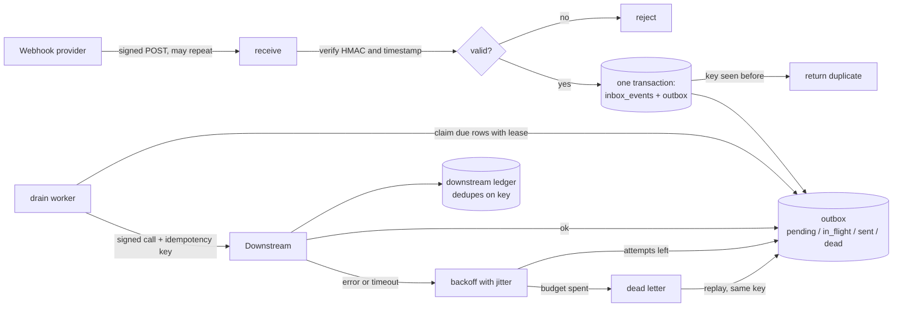

# webhook-reliability-kit

**The problem:** integrations that fail silently. A payment webhook arrives twice and the customer is credited twice. A follow up call times out, nobody knows whether it landed, and the work is either lost or done again.

**Who it is for:** developers and small teams who receive webhooks from third party tools and trigger outbound calls from them (alerts, ledger entries, CRM updates), and need each one to happen once.

**What this shows:** in a simulation where the downstream rejects 30% of calls, loses the response on another 20%, and the worker is killed mid delivery, every accepted event still produces its effect exactly once. Forged and repeated webhooks are dropped at the door. Calls that run out of retries are parked in a dead letter list with their error, not lost, and can be replayed safely.

**How:** signature checks, idempotency keys, a transactional outbox with retry and backoff, dead letters and replay. About 900 lines of Python on the standard library and SQLite, no dependencies, with 58 tests and a seeded chaos run that also runs in CI.

**What it is not:** a hosted service or a drop in library. The provider, the downstream and the failures are all simulated in one process; nothing here has been run against a live service. See [Limitations](#limitations).

## What you will see

`python demo/run_demo.py` runs offline in about a second. These lines are copied from its output (full capture in [`demo/output.txt`](demo/output.txt), and a test fails if they drift):

```
webhook-reliability-kit chaos demo (seed=7, events=60)
downstream fails before applying 30% of calls, loses the response after applying 20%, worker crashes after 5% of successful calls

Run 1: downstream dedupes on the idempotency key
  inbound deliveries        100
    accepted                60
    deduped redeliveries    34
    rejected bad signature  6
  downstream calls          118
    retries scheduled       53
    worker crashes          2
    dead lettered           4 (max 4 attempts)
    replayed after heal     4
    duplicates suppressed   17
    ...
    row 54 dead after 4 attempts (DownstreamError: 503 unavailable, nothing applied)
    downstream healed, replayed 4 dead rows
    ...
  effects missing: 0   effects applied twice or more: 0
  exactly once: YES

Run 2: same seed, downstream ignores the key (control)
    ...
    acct_demo_01: 549.12 / 766.36  WRONG by 217.24
    ...
  effects missing: 0   effects applied twice or more: 14
  exactly once: NO
```

Sixty events took 118 calls to deliver. Seventeen of those calls repeated an effect that had already landed, and the idempotency key absorbed every one. In the control run, with the same traffic and the key ignored, 14 events were credited more than once and every account balance came out wrong. The control is there to show the check can fail.

## What it does

- **Signature verification.** HMAC-SHA256 over `timestamp.body`, constant time compare, a tolerance window that rejects old captures, and a secret list so a secret can be rotated without dropping traffic.
- **Idempotency keys on the way in.** Each inbound event is recorded by key. A redelivery returns `duplicate` and does nothing. The same key with a different body is refused as a conflict.
- **Transactional outbox.** The inbound dedupe row and the outbound work it triggers are written in one SQLite transaction, so an accepted event always has its follow up queued, exactly one time.
- **Drain worker.** Claims due rows under a lease, calls the downstream, and on failure reschedules with exponential backoff and full jitter. A worker that dies mid call leaves a lease that expires, and the row is picked up again. A worker whose call outlived its lease has its late result discarded, so it cannot overwrite what the next worker recorded.
- **Dead letter.** After `max_attempts` the row is parked as `dead` with its last error, and every attempt is kept in `delivery_attempts`.
- **Replay.** A dead (or already sent) row can be put back in the queue with a fresh budget. It keeps its idempotency key, so replaying something that already landed is harmless.
- **Chaos test.** A fake downstream fails at random from a seeded generator, both before applying an effect and after applying it (response lost). The test asserts every accepted event produced exactly one ledger entry and that balances match to the cent. A control run with downstream dedupe turned off must fail.

The honest framing: delivery is at least once. The effect is exactly once only because the downstream dedupes on the idempotency key the sender attaches to every attempt.

## Architecture



In this repository the provider and the downstream are Python objects in the same process, not network services.

| File | Role |
| --- | --- |
| `webhook_kit/signing.py` | sign and verify |
| `webhook_kit/inbox.py` | verify, dedupe, enqueue in one transaction |
| `webhook_kit/outbox.py` | enqueue, claim, drain, dead letter, replay |
| `webhook_kit/backoff.py` | exponential backoff with full jitter |
| `webhook_kit/downstream.py` | seeded flaky downstream with its own ledger database |
| `webhook_kit/chaos.py` | the end to end scenario used by the tests and the demo |
| `webhook_kit/db.py`, `clock.py` | schema, injectable clock |

## Run it

Needs Python 3.10 or newer. Nothing to install for the demo.

```
python demo/run_demo.py
```

Options: `--seed N`, `--events N`, `--log-lines N`. The same seed always prints the same output. The process exits non zero if the safe run is not exactly once, or if the control run fails to show duplicates.

## Tests

```
python -m pip install -r requirements-dev.txt
python -m pytest -q
```

58 tests: signing, backoff bounds, inbox dedupe and rollback, outbox retry, dead letter, replay, lease recovery after a crash, a late result from a worker that lost its lease, two connections on one database file, the demo's exit codes and captured output, and the chaos suite across six seeds plus its control. CI runs the tests and the demo on Ubuntu with Python 3.10 and 3.12.

## Using the pieces

```python
from webhook_kit import connect, receive, enqueue, drain_once, BackoffPolicy
import json, random, time

conn = connect("kit.db")
policy = BackoffPolicy(base_seconds=1.0, cap_seconds=300.0, max_attempts=6)

def handler(tx, event):                      # runs inside the inbox transaction
    enqueue(tx, f"{event['id']}:notify", "notify", json.dumps(event), time.time(), policy.max_attempts)

receive(conn, raw_body, signature_header, ["current-secret", "previous-secret"], time.time(), handler)

def send(row):                               # raise on failure
    post(row["destination"], row["payload"], headers={"Idempotency-Key": row["idempotency_key"]})

drain_once(conn, send, time.time(), random.Random(), policy)
```

`post`, `raw_body` and `signature_header` are yours to supply, and so is the loop that calls `drain_once` on a timer. The kit ships no HTTP client, server or long running worker: keeping transport out keeps the demo offline. The retry budget is stored on each row at `enqueue`; `drain_once` reads only the delay settings from the policy.

## Configuration

All optional, see `.env.example`. The kit does not load `.env` files itself; export the variables in your shell if you want to override the built in fake values.

| Variable | Meaning | Default |
| --- | --- | --- |
| `WEBHOOK_KIT_INBOUND_SECRET` | secret for inbound signatures in the demo | fake placeholder |
| `WEBHOOK_KIT_OUTBOUND_SECRET` | secret for outbound signatures in the demo | fake placeholder |
| `WEBHOOK_KIT_DB` | SQLite path for the sender side | `:memory:` |

With `WEBHOOK_KIT_DB` set to a file, use a fresh file for each run. The fake downstream ledger is always in memory, so the demo refuses a sender file that already holds events (exit code 2) rather than report a mismatch that is not real.

## Where this pattern comes from

The author's description, which this repository cannot prove: the pattern is a clean room rewrite of one used in the back office systems of two small service companies, where inbound events from third party tools trigger alerts and follow up calls. No code or data is shared with those systems. Everything here runs on SQLite with synthetic data (`acct_demo_01`, `evt_0001`).

## Limitations

What is simulated, and has never been run for real:

- **No live service, no network.** The webhook provider is a loop that builds signed JSON bodies. The downstream is the `FlakyDownstream` class, called as a Python function. There is no HTTP server or client anywhere, so real timeouts, TLS, slow responses and connection resets are untested.
- **Signatures use the kit's own header format** (`t=<unix seconds>,v1=<hex>`). It has not been checked against any real provider's signatures; each provider needs its own header parsing.
- **Crashes are an exception, not a killed process.** `WorkerCrash` unwinds the drain loop in the same process. No real `kill -9`, no power loss, no partial write or disk failure testing.
- **Time is a fake clock.** Backoff delays and lease expiry are stepped instantly. `SystemClock` exists but nothing exercises it, and there is no worker loop that sleeps on real time.
- **Concurrency is lightly tested.** Claims use `BEGIN IMMEDIATE`. Tests cover two connections on one file taking turns and one interleaved lost lease, all in one process and one thread. No multi process or load test has been run, so there are no throughput numbers.
- **Platforms.** Run locally on Windows with Python 3.12 and in CI on Ubuntu with Python 3.10 and 3.12. Not run on macOS.

Limits of the design itself:

- **Exactly once depends on the downstream.** If the receiver does not dedupe on the idempotency key, retries will double apply. The control run shows exactly that. Nothing on the sender side can fix it.
- **SQLite means one writer at a time** and one machine. A Postgres version would claim with `FOR UPDATE SKIP LOCKED`; that version is not written.
- **A crash costs the whole claimed batch an attempt.** The attempt counter is bumped at claim time, so rows that were claimed but not yet tried when the worker died still lose one attempt. Use a small batch or a generous budget.
- **A crash on the final attempt is dead lettered with outcome unknown.** The effect may or may not have landed. Replay is safe only because the key is kept.
- **The lease must outlast the whole batch.** `drain_once` stamps one lease for every row it claims and then calls them one after another. If the batch runs past the lease, a second worker sends the remaining rows again. The key still protects the effect and the late result is discarded, but the call is wasted.
- **No ordering guarantee.** Rows for the same entity can be delivered out of order after retries.
- **The idempotency key is read from a field in the JSON body** (`id` by default). Providers that put the event id in a header, or send non JSON bodies, need an adapter.
- **Nothing is pruned.** A real deployment needs a retention window for `inbox_events`, `delivery_attempts` and the downstream key table.
- **No metrics or alerting.** Dead letters sit in a table until something queries it.

License: MIT, see the LICENSE file.
